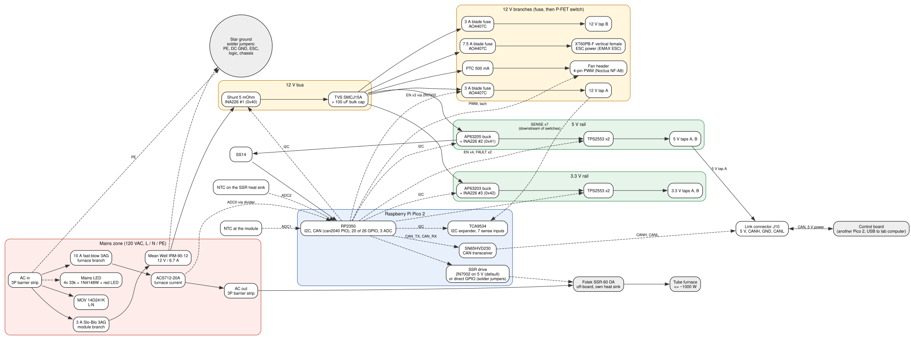

# Tool power supply

A general-purpose power supply board for HackerFab tools. Rev 1 targets the **spin coater** (A2212 930KV BLDC through an EMAX ESC) and the **tube furnace** (up to about 1000 W, switched by an off-board Fotek SSR-60 DA), and also gives general 12 V / 5 V / 3.3 V taps for future tools. A Raspberry Pi Pico 2 monitors and controls it.

Status: **rev 1 schematic done, PCB layout restarted at 90 x 160 mm (120 x 80 mm did not fit); a scripted placement is in the project PCB (method in `tools/pcb_placement/`), no routing.** Nothing has been fabricated. Several numbers (creepage, thermal, ESC behavior) are from memory or summaries and are flagged as unverified in the design docs; check them before ordering boards.

Spec source: the Notion page "Power Board Spec Sheet" (HackerFab Central / Electrical): https://app.notion.com/p/38d37907206980e6a0a9c241ee033941. Fab and assembly are planned through JLC (LCSC part numbers in the BOM); through-hole parts are hand-soldered and can come from Digikey or Mouser.

## What the board does



- **120 VAC in** (barrier strip, L / N / PE) splits into two fused branches: a 3 A time-lag branch into the on-board **Mean Well IRM-90-12** (12 V, 6.7 A, 80 W), and a 10 A fast-blow branch through an ACS712 current sensor to the **AC out** barrier strip. An external SSR in the heater's hot lead switches the furnace.
- **12 V bus** (module output) with a 5 mOhm INA226 monitor, an SMCJ15A TVS and a 100 uF bulk cap. There is **no 24 V bus** and no diode between the module and the bus.
- **12 V outputs:** two taps (3 A blade fuse each) and the ESC branch (7.5 A blade fuse, XT60 female). Each is a fuse, then a high-side AO4407C P-FET switch.
- **5 V and 3.3 V rails:** AP63205 and AP63203 fixed bucks off the 12 V bus, each with an INA226 monitor, then two TPS2553 current-limited taps per rail.
- **Pico 2** plugs into sockets. It reads the three INA226s over I2C, switches every DC tap (default ON, pulled low to turn off), senses whether each tap output is present, reads furnace current and two NTCs, drives the SSR through a 2N7002, and drives a 4-pin PWM fan header.
- **Power budget:** sized for **one tool at a time** (spin coater worst case about 70 W). It is not enforced in hardware, so the 6.7 A limit should be labeled on the board.

Out of scope for rev 1: the litho tool (it keeps its own supplies), the ESC throttle signal (a separate microcontroller handles it), and the thermocouple interface.

## Repository map

| Path | What it is |
|---|---|
| `design-context/design-decisions.md` | Working memory: every decision with its rationale, open questions, datasheet-derived numbers and sourcing. Start here for "why is it like this". |
| `design-context/bom.md` | Rev 1 BOM (LCSC / Digikey / Mouser part numbers, quantities, JLC vs hand assembly). |
| `design-context/pin-map.md` | Pico 2 GPIO assignment, tap sense circuits, 12 V switch circuit, INA226 addresses. |
| `design-context/power-tree.md` | Generated power tree with consumption per rail and per tap, module budget by scenario. Regenerate with `python3 tools/power_tree/gen_power_tree.py`. |
| `design-context/block-diagram.svg` | Block diagram (Graphviz source `block-diagram.dot`; Mermaid version in `block-diagram.md`). |
| `design-context/pcb-placement.md` | Board outline, zone plan and placement assumptions for the first-pass PCB. |
| `design-context/footprint-sourcing.md` | Which symbols and footprints come from stock KiCad, the HackerFab library, or need downloading. |
| `tool-power-supply-v1/` | The KiCad 10 project: root sheet plus `mains`, `bus12v`, `rails`, `mcu` sub-sheets. |
| `tools/power_tree/` | Generator for `power-tree.md`: reads the schematic through the kicad-happy `kicad` skill and `power_model.json` (off-board loads and assumptions, each with a source). |
| `tools/schematic/` | Python generator that wrote the schematic (see "Working on the schematic"). |
| `datasheets/` | Datasheets referenced by the decisions (INA226, TPS2553, ACS712, Pico 2, EMAX ESC, and rejected parts). |

## Reviewing the design

1. Read the block diagram above, then the "Decided" sections of `design-context/design-decisions.md`.
2. Open `tool-power-supply-v1/tool-power-supply-v1.kicad_pro` in **KiCad 10**. The schematic is hierarchical: the root sheet shows four sheet symbols joined by sheet pins and bus groups (`I2C`, `EN`, `SENSE`, `FAULT`, `FAN`), and the sheets are wired functional blocks with power symbols and no global labels.
3. Symbols and footprints come from the stock KiCad libraries plus the HackerFab libraries (`hackerfab-kicadlibs`, https://github.com/UBC-Hacker-Fab). A few parts (TPS2553, the 3AG and blade fuses with their clip/holder footprints, barrier strip, IRM-90-12) are only in the HackerFab library, so clone that repo and add its libraries to KiCad before opening the project.
4. Check the BOM (`design-context/bom.md`) against the schematic and pin map.

Current check results: ERC has 0 errors and 2 expected warnings (the Pico's GND and AGND power-output pins tied to the module's -VO pin). The exported netlist matches the intended pin-to-net table for all 79 nets.

## Known gaps and open items

- **PCB: placement only** (90 x 160 mm, re-placed 2026-10-16 with M2 holes in all four corners, the 10D241K MOV and mains net classes plus `.kicad_dru` rules for 3.2 mm mains-to-anything and 1.6 mm L-to-N clearance from IEC 60664-1; see `design-context/pcb-placement.md` and `tools/pcb_placement/`; no tracks, zones or slots). Layout still needs a mains zone along one board edge, routed creepage slots (under the IRM-90-12, around the ACS712 and the mains LED dropper), wide pours for the roughly 8.3 A furnace path, and the star-ground solder jumpers (PE, DC GND, ESC, logic, chassis; default open).
- **Schematic omissions:** X2 cap, test points, a gate clamp for the 12 V P-FETs (check Vgs against the 25 V limit during a TVS clamp), and the AO4407C uses the stock FDS9435A symbol. The 120 VAC 3AG fuses (F1, F2) are one symbol each with a custom two-clip footprint (34.21 mm between the clips, from the Littelfuse datasheet); the DC blade fuses (F4, F5, F6) are one symbol each with the Keystone 3557 holder as the footprint, so there are no separate clip or holder symbols.
- **Unverified assumptions:** the ESC's regen behavior (the IRM-90-12 latches off above 12.6 to 16.2 V and needs a power cycle; the design relies on ESC Brake OFF and a ramped throttle), the ESC's own input capacitance (the 100 uF bulk cap assumes the ESC has some), the Fotek SSR's real ratings, creepage numbers (now derived from IEC 60664-1 in `design-guides/`, still to be confirmed), and the Noctua fan's PWM and tach levels. The EMAX manual in `datasheets/` is for the NANO series, not the Simon series in use.
- **Decided 2026-10-21 (design review), not yet in the schematic or PCB:** the board becomes a CAN peripheral of the control board (a second Pico 2 on USB to a lab computer, powered from this board's 5 V). The Pico 2 stays and uses the can2040 PIO CAN library with an SN65HVD230 transceiver; a PCA9535C I2C expander takes the 7 sense inputs (25 of 26 GPIO becomes 20); mounting holes become floating M3 plated holes with ring vias; the ESC XT60 becomes a vertical female. Future note: the control board should fall back to USB power if the power board fails. Details in `design-context/design-decisions.md`.
- **Not yet sourced:** M2 hardware and standoffs, the SSR heat sink and wiring, and the DNP dump-load footprint.
- Prices and stock figures date from 2026-10-11 to 2026-10-14. Re-check before ordering.

## Working on the schematic

The schematic was generated from Python tables, and `tools/schematic/design.py` is the source of truth for components and nets.

```sh
python3 tools/schematic/build2.py   # regenerate tool-power-supply-v1/*.kicad_sch
```

It needs KiCad 10 installed at `/Applications/KiCad/KiCad.app` and `hackerfab-kicadlibs` cloned at `~/Documents/Github/hackerfab-kicadlibs`. **Regenerating overwrites any edits made in KiCad.** The schematic is now being edited by hand, so do not rerun the generator unless you have agreed to throw those edits away (it refuses to run while KiCad's `~*.lck` file exists); `design.py` can drift from the `.kicad_sch` files. `tools/schematic/README.md` has details.

## Power tree

`design-context/power-tree.md` is generated from the schematic, so rerun `python3 tools/power_tree/gen_power_tree.py` after any schematic or load change (`--check` reports whether the committed file is stale). It needs Python 3.10+ and the kicad-happy `kicad` skill (default `~/.claude/skills/kicad`, override with `KICAD_HAPPY_SKILL`). Tap and overhead currents live in `tools/power_tree/power_model.json`; the generator fails if a ref in that file no longer matches the schematic. Headline result today: the spin-coater case draws about 5.9 A of the module's 6.7 A, and loading every tap at once exceeds the module, as expected for a one-tool-at-a-time design.

## Keeping this README current

This file is the first point of contact, so it must match the design. When a decision, the architecture, the BOM, the schematic status or the open items change, update the relevant section here in the same change, alongside `design-context/design-decisions.md` (which holds the detail and history).
