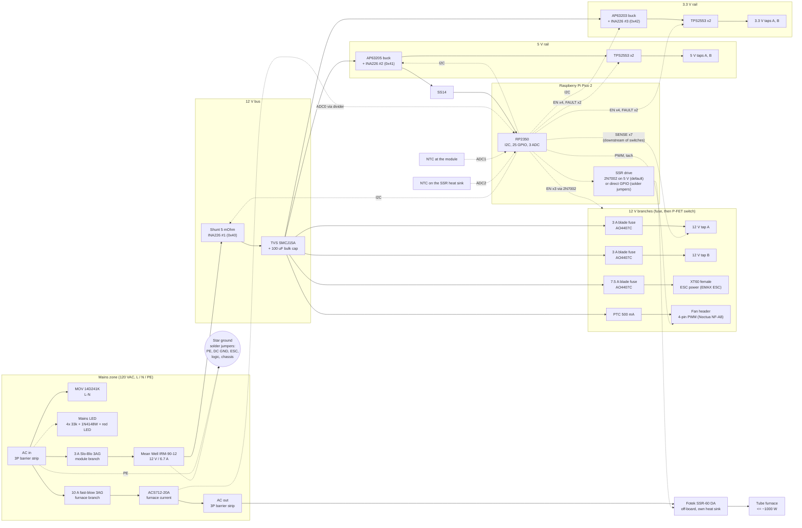

# Rev 1 block diagram (2026-10-14)

An SVG render is in `block-diagram.svg` (Graphviz source: `block-diagram.dot`, regenerate with `dot -Tsvg block-diagram.dot -o block-diagram.svg`).

Mermaid source (renders on GitHub and in most Markdown viewers). Built from `design-decisions.md`, `bom.md` and `pin-map.md`. Dashed lines are signals, solid lines are power.

## Reading notes
- The IRM-90-12 isolates mains (4 kVAC), so everything right of it is SELV. The ACS712 and the mains LED straddle the barrier and need creepage care in layout.
- No diode between the module and the bus (dropped for rev 1): the ESC runs with Brake OFF and a ramped throttle from its separate controller.
- The AC passthrough (AC in to AC out) is not switched or power-cycled. The SSR switches the heater lead off-board.
- All seven DC taps (5 V x2, 3.3 V x2, 12 V x2, ESC) are switchable (default ON through pull-ups) and each has a downstream presence sense for self-test; per-tap current comes from the per-rail INA226 delta.
